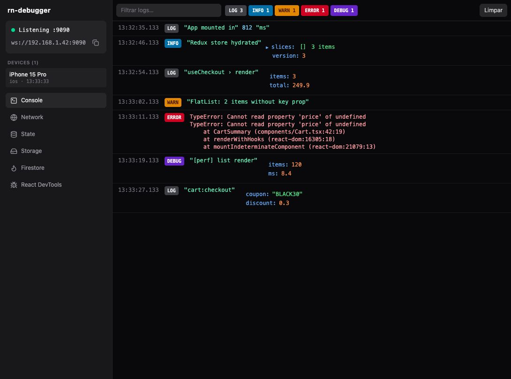
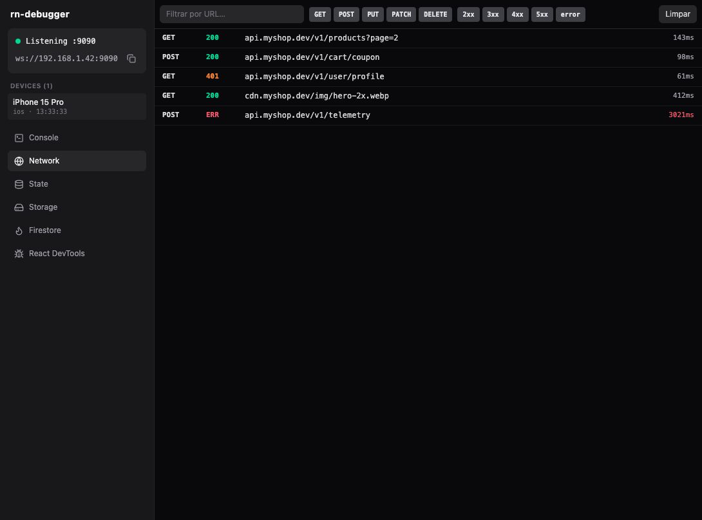
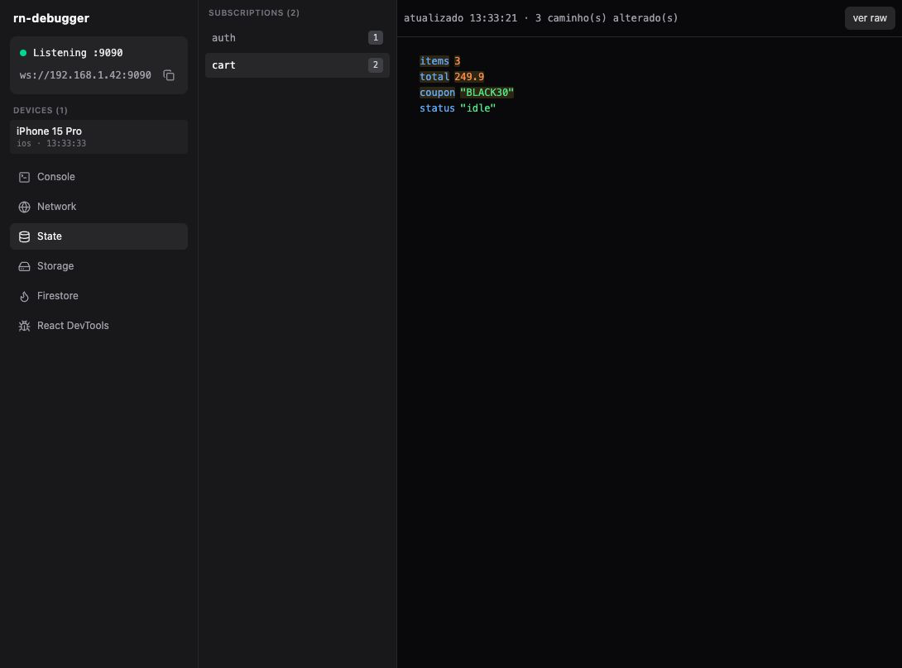
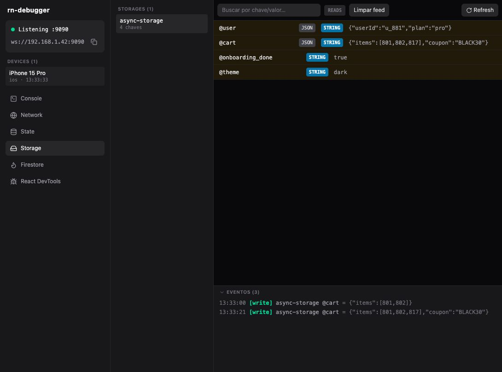
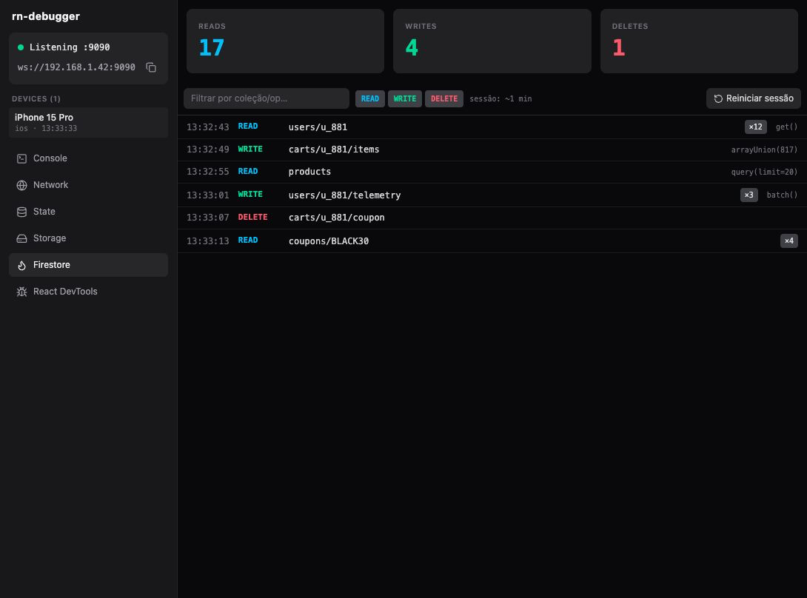
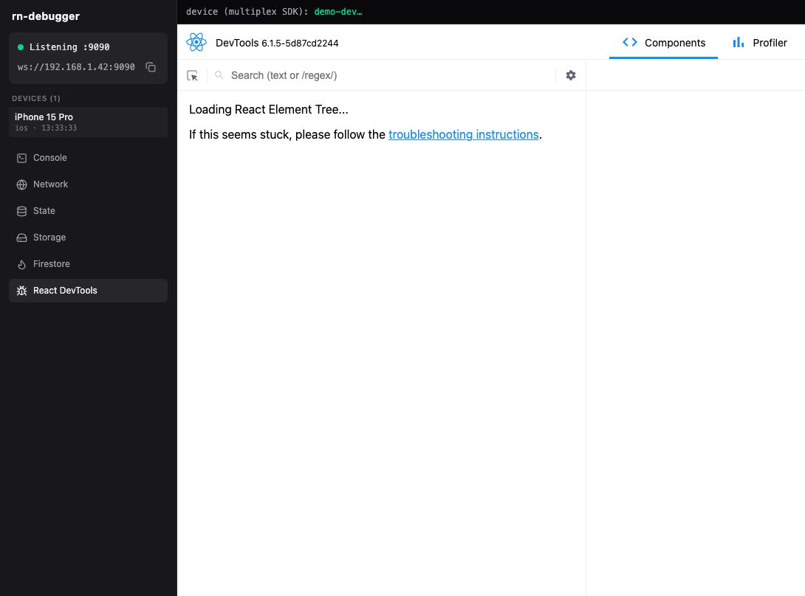

<div align="center">

# rn-debugger

**The zero-config debugger for React Native & Expo**

Console · Network · State · Storage · Firestore · React DevTools — one desktop app.

[](https://www.npmjs.com/package/rn-debugger)
[](https://github.com/JereLima/rn-debugger/actions/workflows/ci.yml)
[](LICENSE)

[English](#english) · [Português](#português)

</div>

---

<a id="english"></a>

## English

One desktop app (macOS / Windows / Linux) with everything you need while developing a React Native app:

| Feature | What you get |
|---|---|
| **Console** | logs, warnings, errors with stack traces, object serialization, search & level filters |
| **Network** | every fetch/XHR — method, status, duration, headers, pretty JSON bodies |
| **State** | Zustand / Redux / any store — snapshots with a visual **diff** of what changed |
| **Storage** | AsyncStorage & MMKV — all keys/values plus a live event feed |
| **Firestore** *(experimental)* | read/write/delete counters and an operation feed per session |
| **React DevTools** | the official component tree, embedded |

### Quickstart

1. Download the desktop app for your OS from [Releases](https://github.com/JereLima/rn-debugger/releases)
2. Install the SDK in your app:

   ```bash
   npm i rn-debugger
   ```

3. Add it to your `App.tsx` (Expo):

   ```ts
   import { addDebug } from "rn-debugger/expo";
   addDebug();
   ```

   Plain React Native (`index.js`) — zero config on simulators, manual host on physical devices:

   ```ts
   import { addDebug } from "rn-debugger";
   addDebug({ host: "192.168.1.5" });
   ```

4. Run your app — it connects automatically. That's it.

No config file, no native modules, works in **Expo Go** — even on physical devices, because the SDK discovers the dev server's IP from the Expo manifest. Dev-only: the SDK is a no-op in production builds (`__DEV__ === false`).

### Screenshots

<table>
  <tr>
    <td width="50%"></td>
    <td width="50%"></td>
  </tr>
  <tr>
    <td width="50%"></td>
    <td width="50%"></td>
  </tr>
  <tr>
    <td width="50%"></td>
    <td width="50%"></td>
  </tr>
</table>

### How it connects

The desktop app runs a WebSocket server on port **9090**. The SDK tries, in order: an explicit `host`, the Expo dev server IP (from the app manifest), `10.0.2.2` (Android emulator) and `localhost`. First one that answers wins — and it reconnects automatically if the desktop app restarts.

### API

```ts
addDebug(options?: { host?: string; port?: number; reactDevTools?: boolean })

// State — snapshots + diff
debugState(name, getState, subscribe?)
debugRedux(store, name?)
debugZustand(store, name?)

// Storage — always pass the module/instance as an argument
debugAsyncStorage(AsyncStorage)
debugMMKV(instance, name?)
```

### Comparison

| | rn-debugger | Reactotron | react-native-debugger | Flipper |
|---|---|---|---|---|
| Maintained | ✅ | slow | legacy (no Hermes / new arch) | discontinued |
| Setup | `addDebug()` | setup + manual host | bundler flags | native app on device |
| Works in Expo Go | ✅ | ✅ | ❌ | ❌ |
| Storage (AsyncStorage/MMKV/Firestore) | ✅ | partial | ❌ | via JS plugins |
| React DevTools | ✅ | ❌ | ✅ | ❌ |

### Troubleshooting

Device not connecting? Windows firewall, `--tunnel` mode, port conflicts and more in [docs/troubleshooting.md](docs/troubleshooting.md).

**macOS note:** first releases are unsigned. If macOS blocks the app:

```bash
xattr -cr /Applications/RN\ Debugger.app
```

### Roadmap

- [ ] v0.1 — console, network, state, storage, React DevTools *(current)*
- [ ] Stable Firestore inspector (currently experimental)
- [ ] Editable state (dispatch actions from the desktop)
- [ ] Request replay / mock

---

<a id="português"></a>

## Português

Um app desktop (macOS / Windows / Linux) com tudo que você precisa para desenvolver apps React Native:

| Funcionalidade | O que você tem |
|---|---|
| **Console** | logs, warnings, erros com stack trace, serialização de objetos, busca e filtros por nível |
| **Network** | todo fetch/XHR — método, status, duração, headers, JSON formatado |
| **State** | Zustand / Redux / qualquer store — snapshots com **diff visual** do que mudou |
| **Storage** | AsyncStorage & MMKV — todas as chaves/valores + feed de eventos ao vivo |
| **Firestore** *(experimental)* | contadores de leitura/escrita/deleção e feed de operações por sessão |
| **React DevTools** | a árvore de componentes oficial, embutida |

### Começando

1. Baixe o app desktop para o seu OS nas [Releases](https://github.com/JereLima/rn-debugger/releases)
2. Instale o SDK no seu app:

   ```bash
   npm i rn-debugger
   ```

3. Adicione no seu `App.tsx` (Expo):

   ```ts
   import { addDebug } from "rn-debugger/expo";
   addDebug();
   ```

   React Native puro (`index.js`) — zero config no simulador; em device físico, informe o host:

   ```ts
   import { addDebug } from "rn-debugger";
   addDebug({ host: "192.168.1.5" });
   ```

4. Rode seu app — a conexão é automática. Simples assim.

Sem arquivo de config, sem módulo nativo, funciona no **Expo Go** — inclusive em device físico, porque o SDK descobre o IP do dev server a partir do manifest do Expo. Só em dev: em build de produção o SDK vira no-op (`__DEV__ === false`).

### Screenshots

<table>
  <tr>
    <td width="50%"></td>
    <td width="50%"></td>
  </tr>
  <tr>
    <td width="50%"></td>
    <td width="50%"></td>
  </tr>
  <tr>
    <td width="50%"></td>
    <td width="50%"></td>
  </tr>
</table>

### Como a conexão funciona

O app desktop roda um servidor WebSocket na porta **9090**. O SDK tenta, nesta ordem: um `host` explícito, o IP do dev server do Expo (extraído do manifest), `10.0.2.2` (emulador Android) e `localhost`. O primeiro que responder vence — e a reconexão é automática quando o app desktop reinicia.

### API

```ts
addDebug(options?: { host?: string; port?: number; reactDevTools?: boolean })

// State — snapshots + diff
debugState(name, getState, subscribe?)
debugRedux(store, name?)
debugZustand(store, name?)

// Storage — sempre passe o módulo/instância como argumento
debugAsyncStorage(AsyncStorage)
debugMMKV(instance, name?)
```

### Comparação

| | rn-debugger | Reactotron | react-native-debugger | Flipper |
|---|---|---|---|---|
| Mantido | ✅ | lento | legado (sem Hermes / new arch) | descontinuado |
| Setup | `addDebug()` | setup + host manual | flags no bundler | app nativo no device |
| Funciona no Expo Go | ✅ | ✅ | ❌ | ❌ |
| Storage (AsyncStorage/MMKV/Firestore) | ✅ | parcial | ❌ | plugins JS |
| React DevTools | ✅ | ❌ | ✅ | ❌ |

### Problemas comuns

Device não conecta? Firewall no Windows, modo `--tunnel`, conflito de portas e mais em [docs/troubleshooting.md](docs/troubleshooting.md) (em inglês).

**Nota macOS:** as primeiras releases não são assinadas. Se o macOS bloquear o app:

```bash
xattr -cr /Applications/RN\ Debugger.app
```

## Contributing

See [CONTRIBUTING.md](CONTRIBUTING.md). MIT license — see [LICENSE](LICENSE).
